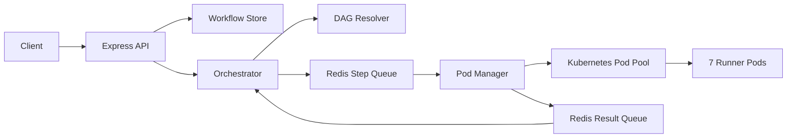

# Mini Workflow Orchestrator

A lightweight workflow orchestration engine built with **Bun**, **Express**, **Redis**, and **Kubernetes**. It accepts workflows containing shell commands and dependencies, schedules ready steps, executes commands inside Kubernetes runner pods, and tracks execution status.

## Progress

- [x] Section 1: Core orchestration
- [ ] Section 2: Parallel execution
- [ ] Section 3: Failure handling, retries, and timeouts

## Architecture



## How It Works

1. A client submits a workflow through `POST /workflow`.
2. The orchestrator initializes and stores the workflow, then identifies ready steps using the DAG resolver.
3. Ready steps are marked `QUEUED` and added to the Redis step queue.
4. The pod manager leases a runner pod and executes each command.
5. Execution events (`RUNNING`, `COMPLETED`, or `FAILED`) are published to the Redis result queue.
6. The orchestrator consumes these events, updates workflow state, and schedules newly unblocked steps.

> **Design principle:** The orchestrator owns workflow state. The pod manager executes commands and reports results without modifying workflow state directly.

## Section 1 Implementation

| File | Implementation |
| --- | --- |
| `src/backend/dag.ts` | Resolves steps that are ready to execute |
| `src/backend/orchestrator.ts` | Workflow submission, background processing, result handling, and step dispatching |
| `src/pod-manager/pod-manager.ts` | Pod leasing, command execution, result reporting, and pod release |
| `src/backend/server.ts` | Workflow submission and status endpoints |
| `src/index.ts` | Starts the orchestrator on application startup |

The Redis client, queue infrastructure, pod pool, workflow store, and shared types are provided by the starter boilerplate.

### DAG Resolution

A step is ready when:

- Its status is `PENDING`.
- All dependencies have status `COMPLETED`.

Steps without dependencies are immediately eligible. Steps that are already `QUEUED`, `RUNNING`, or `COMPLETED` are not scheduled again.

The resolver uses the current statuses from the workflow store to avoid duplicate scheduling.

### Workflow Submission

`submitWorkflow()`:

1. Initializes every step as `PENDING` with `podId: null`.
2. Saves the workflow before queuing any steps.
3. Resolves the initially ready steps.
4. Marks ready steps as `QUEUED` and pushes them into the Redis step queue.

Saving the workflow first ensures that the result handler can find its state when execution events arrive.

### Execution and Result Handling

The pod manager:

1. Acquires a runner pod.
2. Reports the `RUNNING` event.
3. Executes the shell command.
4. Reports `COMPLETED` with output and exit code, or `FAILED` with an error.
5. Releases the pod in a `finally` block.

The orchestrator runs two background loops: a **result reader** and a **step dispatcher**. On successful completion, the result reader updates the workflow, resolves the DAG again, and queues newly eligible steps.

### Step Lifecycle

```text
PENDING → QUEUED → RUNNING → COMPLETED
                            ↘ FAILED
```

Workflow status is derived from the current step statuses:

| Workflow status | Condition |
| --- | --- |
| `pending` | All steps are `PENDING` |
| `running` | At least one step is `QUEUED` or `RUNNING` |
| `completed` | All steps are `COMPLETED` |
| `failed` | At least one step is `FAILED` |

## Prerequisites

- Docker
- kind
- kubectl
- Bun

Redis runs locally in Docker.

## Setup

### 1. Install dependencies

```bash
bun install
```

### 2. Start Redis

```bash
docker run -d --name workflow-redis -p 6379:6379 redis
```

If the container already exists:

```bash
docker start workflow-redis
```

### 3. Create the Kubernetes cluster and runner pods

```bash
chmod +x k8s/setup.sh
./k8s/setup.sh
```

### 4. Verify runner pods

```bash
kubectl get pods -n workflow-runner
```

Expected: `runner-0` through `runner-6` are all `Running`.

### 5. Start the server

```bash
bun run dev
```

## API Endpoints

### `POST /workflow`

Submits a workflow for background execution.

Example request:

```bash
curl -X POST http://localhost:3000/workflow \
  -H "Content-Type: application/json" \
  -d '{
    "workflowId": "wf-section-1",
    "steps": [
      { "id": "A", "command": "echo A" },
      { "id": "B", "command": "echo B", "dependsOn": ["A"] },
      { "id": "C", "command": "echo C", "dependsOn": ["B"] }
    ]
  }'
```

Expected response:

```json
{
  "workflowId": "wf-section-1",
  "status": "accepted"
}
```

### `GET /workflow/:id`

Returns the current workflow and step statuses.

```bash
curl http://localhost:3000/workflow/wf-section-1
```

Returns `404` if the workflow ID is unknown.

### `GET /pods`

Shows runner pod availability and active leases.

```bash
curl http://localhost:3000/pods
```

Example response when all seven pods are available:

```json
{
  "total": 7,
  "available": 7,
  "leased": []
}
```

## Testing

### Run tests

```bash
bun test
```

### Verify Section 1 end to end

Submit the three-step chain shown above, then poll:

```bash
curl http://localhost:3000/workflow/wf-section-1
```

Expected final result:

- All three steps reach `COMPLETED`.
- Each command executes in dependency order: `A → B → C`.
- Successful commands report exit code `0`.
- Workflow status becomes `completed`.

### Inspect Redis queues

Use the queue keys printed when the server starts:

```bash
docker exec workflow-redis redis-cli LRANGE "workflow:12345:step-queue" 0 -1
docker exec workflow-redis redis-cli LRANGE "workflow:12345:result-queue" 0 -1
```

Replace the example keys with the actual keys from your server logs.

## Design Decisions

- **Single source of truth:** The orchestrator is responsible for workflow state updates.
- **Save before enqueue:** Prevents execution results from arriving before the workflow is stored.
- **State-driven scheduling:** The DAG resolver uses actual step statuses to avoid duplicate scheduling.
- **Reliable pod cleanup:** Acquired pods are released in a `finally` block.
- **Derived workflow status:** Workflow status is calculated from step statuses rather than stored separately.
- **Asynchronous workflow submission:** The API acknowledges a workflow while execution continues in the background.

## Current Limitations

- **Sequential execution:** Only one step runs at a time, even when multiple steps are ready.
- **Failed dependencies:** Dependent steps can remain `PENDING` after an upstream step fails.
- **No retries or timeout handling:** Failed or stuck executions are not automatically recovered.
- **In-memory workflow storage:** Workflow state is lost when the server restarts.
- **Potential blocking execution:** A blocking `kubectl exec` fallback may temporarily delay other HTTP requests.

## Next Steps

- **Section 2:** Execute independent ready steps concurrently, up to available runner pod capacity.
- **Section 3:** Add failure propagation, skipped steps, retry policies, timeouts, and stuck-execution recovery.