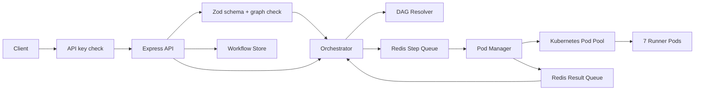
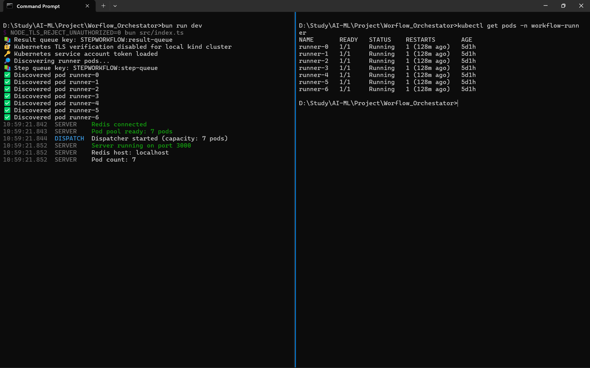
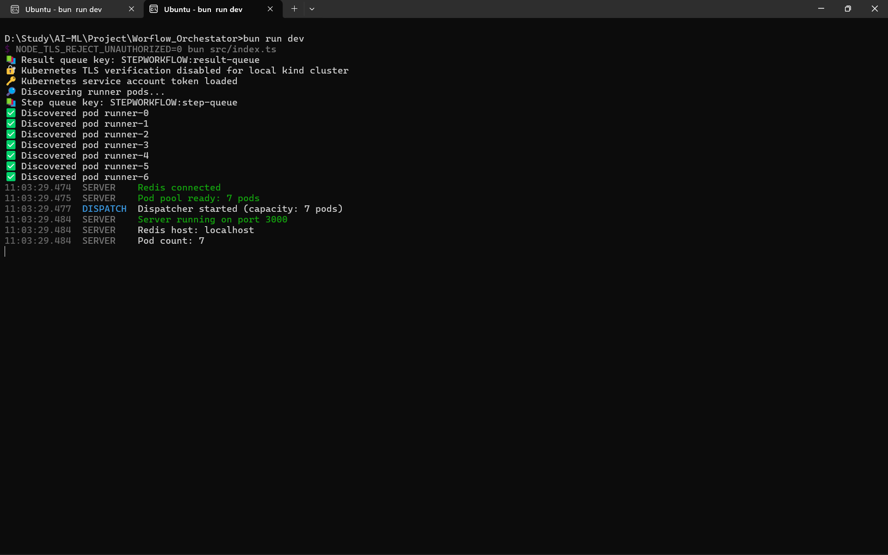
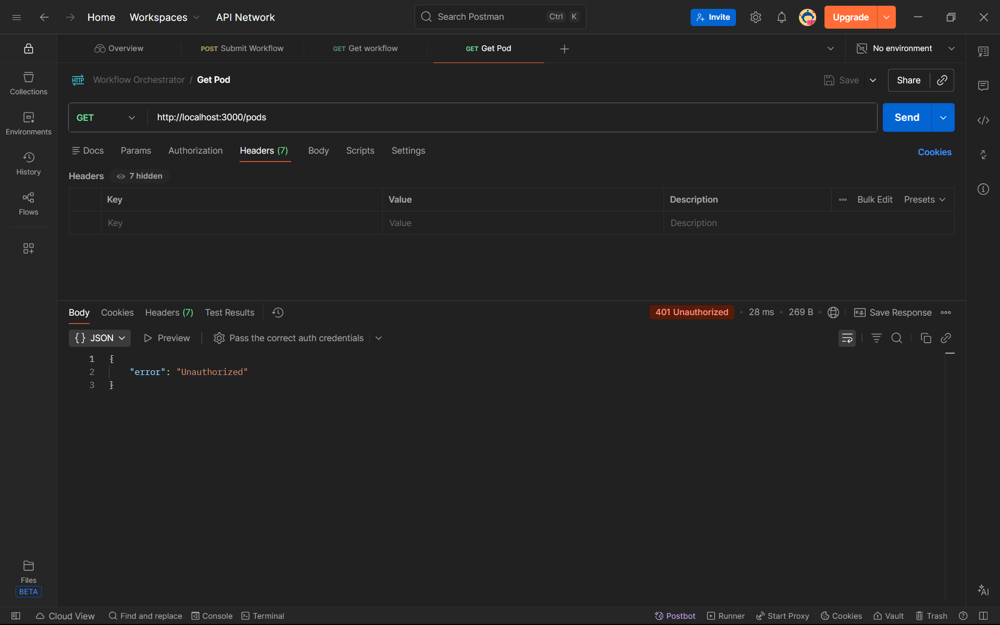
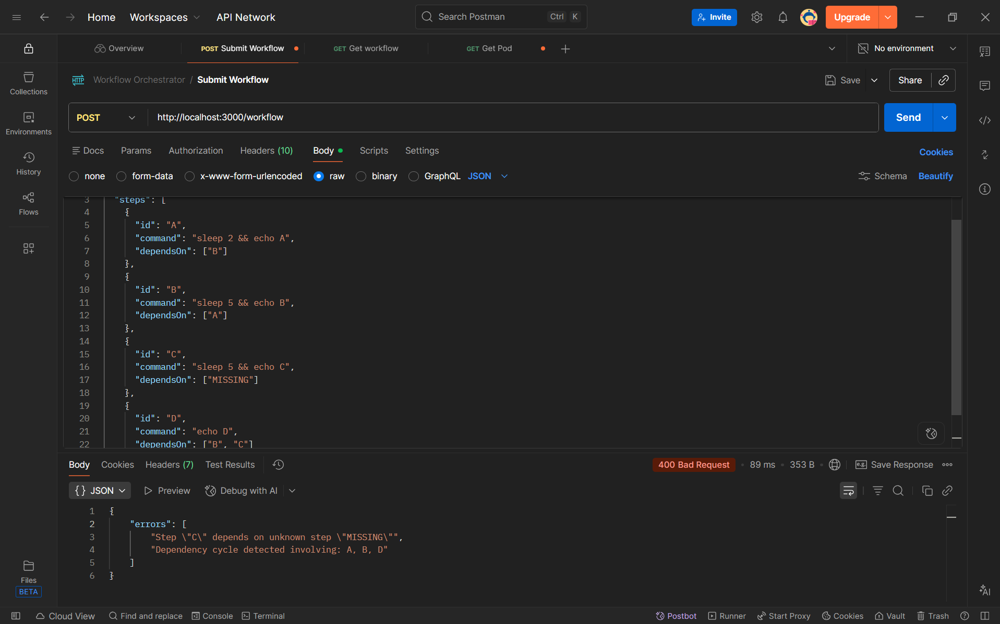
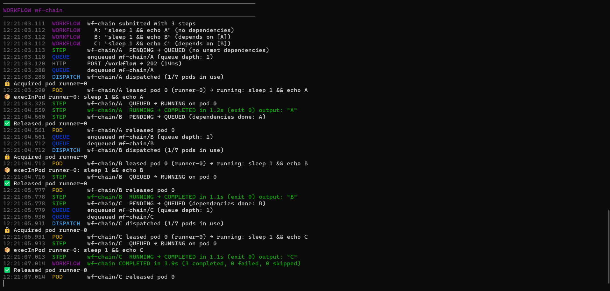
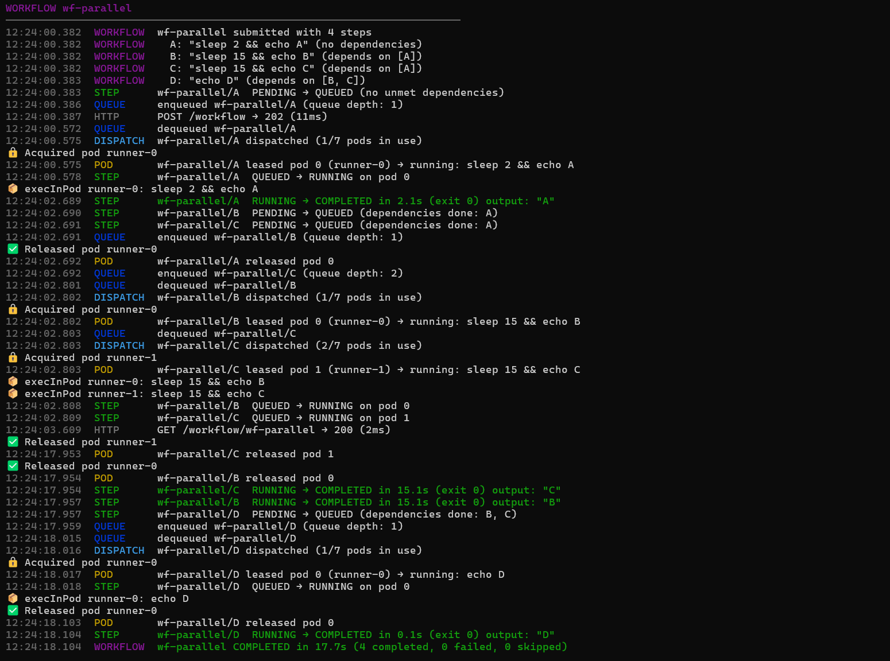
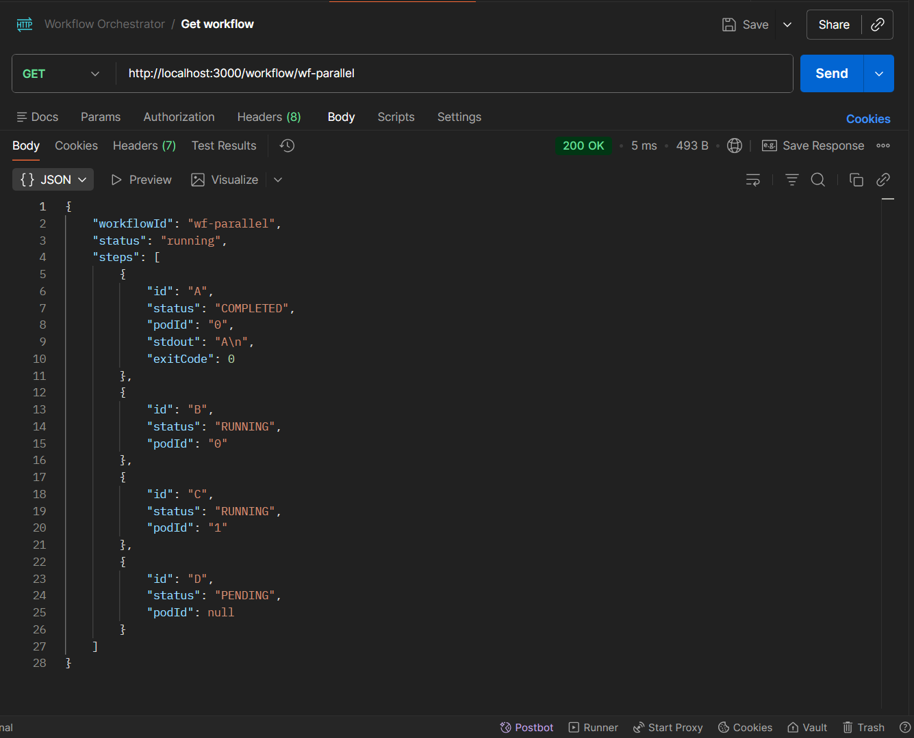
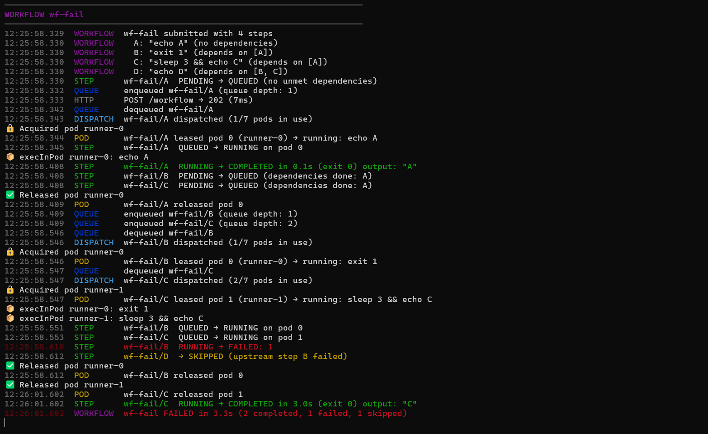
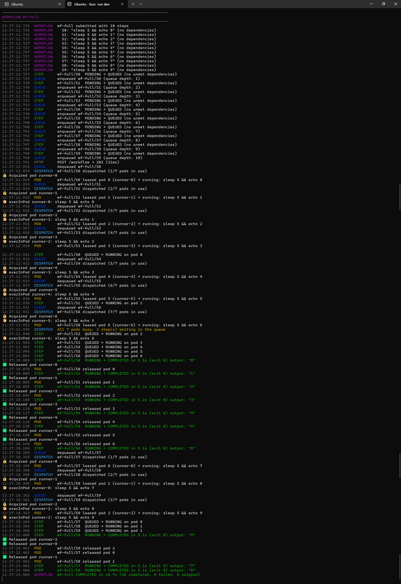

# Mini Workflow Orchestrator

A lightweight workflow orchestration engine built with **Bun**, **Express**, **Redis**, and **Kubernetes**. It accepts workflows containing shell commands and dependencies, schedules ready steps, executes commands inside Kubernetes runner pods, and tracks execution status.

## Progress

- [x] Section 1: Core orchestration
- [x] Section 2: Parallel execution
- [~] Section 3: Failure handling, retries, and timeouts (failure propagation and skipped steps are done; retries and timeouts are not)
- [x] Hardening: API key authentication, request validation, structured logging

## Architecture



## How It Works

1. A client submits a workflow through `POST /workflow` with an `x-api-key` header. The request is authenticated, then validated (schema and dependency graph).
2. The orchestrator initializes and stores the workflow, then identifies ready steps using the DAG resolver.
3. Ready steps are marked `QUEUED` and added to the Redis step queue.
4. The dispatcher hands queued steps to the pod manager, up to one per runner pod, without waiting for earlier steps to finish. The pod manager leases a runner pod and executes each command.
5. Execution events (`RUNNING`, `COMPLETED`, or `FAILED`) are published to the Redis result queue.
6. The orchestrator consumes these events, updates workflow state, and schedules newly unblocked steps. If a step fails, every step downstream of it is marked `SKIPPED`.

> **Design principle:** The orchestrator owns workflow state. The pod manager executes commands and reports results without modifying workflow state directly.

## Section 1 Implementation

| File | Implementation |
| --- | --- |
| `src/backend/dag.ts` | Resolves steps that are ready to execute |
| `src/backend/orchestrator.ts` | Workflow submission, background processing, result handling, and step dispatching |
| `src/pod-manager/pod-manager.ts` | Pod leasing, command execution, result reporting, and pod release |
| `src/backend/server.ts` | Workflow submission and status endpoints |
| `src/index.ts` | Starts the orchestrator on application startup |

The Redis client, queue infrastructure, pod pool, workflow store, and shared types are provided by the starter boilerplate.

### DAG Resolution

A step is ready when:

- Its status is `PENDING`.
- All dependencies have status `COMPLETED`.

Steps without dependencies are immediately eligible. Steps that are already `QUEUED`, `RUNNING`, or `COMPLETED` are not scheduled again.

The resolver uses the current statuses from the workflow store to avoid duplicate scheduling.

### Workflow Submission

`submitWorkflow()`:

1. Initializes every step as `PENDING` with `podId: null`.
2. Saves the workflow before queuing any steps.
3. Resolves the initially ready steps.
4. Marks ready steps as `QUEUED` and pushes them into the Redis step queue.

Saving the workflow first ensures that the result handler can find its state when execution events arrive.

### Execution and Result Handling

The pod manager:

1. Acquires a runner pod.
2. Reports the `RUNNING` event.
3. Executes the shell command.
4. Reports `COMPLETED` with output and exit code, or `FAILED` with an error.
5. Releases the pod in a `finally` block.

The orchestrator runs two background loops: a **result reader** and a **step dispatcher**. On successful completion, the result reader updates the workflow, resolves the DAG again, and queues newly eligible steps.

### Step Lifecycle

```text
PENDING → QUEUED → RUNNING → COMPLETED
                            ↘ FAILED
PENDING → SKIPPED   (an upstream step failed)
```

Workflow status is derived from the current step statuses, checked in this order:

| Workflow status | Condition |
| --- | --- |
| `failed` | At least one step is `FAILED` **and** no step is `QUEUED` or `RUNNING` |
| `pending` | All steps are `PENDING` |
| `completed` | All steps are `COMPLETED` |
| `running` | Anything else, including a failed step while other branches are still working |

A failure does not end the workflow immediately. Independent branches keep running, and the workflow only reports `failed` once they have finished.

## Section 2 Implementation

Section 2 runs independent steps at the same time. In the diamond workflow below, B and C both depend only on A, so once A completes they run in parallel on different pods.

```text
   A
 /   \
B     C
 \   /
   D
```

The change is in the dispatcher loop in `src/backend/orchestrator.ts`. The pod manager, result handler, and API are unchanged.

### Parallel Dispatcher

In Section 1 the dispatcher waited for each step to finish before taking the next one. It now starts a step and immediately goes back for the next, until every runner pod is busy.

```text
loop forever:
  if running steps >= total pods:  wait briefly, try again   (step stays in Redis)
  take the next step from the step queue
  if the queue is empty:           wait briefly, try again
  running += 1
  start the step on the pod manager without awaiting it
    on error:  log it
    finally:   running -= 1
```

- **Capacity is checked before dequeuing.** When all pods are busy, waiting steps stay in the Redis step queue, in order, until a pod is released.
- **Dispatch is not awaited.** Each step runs in the background. A `.catch()` handles its errors and a `.finally()` frees its slot, whether it succeeded or failed.

### Concurrency Counter

The orchestrator keeps its own count of running steps instead of relying on the pod pool's `available` value.

`acquirePod()` contains an `await` before it marks a pod as leased. If the dispatcher read `available` right after starting a step, that step's pod would not be counted yet. With one pod left, the dispatcher could take two steps off the queue, and the second would fail with `NO_POD_AVAILABLE`.

The counter is increased on the same line that starts the step, with no `await` in between, so it is never out of date. This is how the "lease map must be checked atomically" rule is met.

### Queued Before Enqueue

A step is marked `QUEUED` before it is pushed onto the step queue. Steps now start almost instantly, so if the order were reversed, the step's `RUNNING` event could arrive while the push was still being awaited, and would then be overwritten back to `QUEUED`.

### Concurrency Rules

| Rule | How it is met |
| --- | --- |
| Run ready steps simultaneously | The dispatcher does not await a step before starting the next |
| Never assign the same pod to two steps | `acquirePod()` leases each pod to one caller, and the dispatcher never starts more steps than there are pods |
| Check the lease map atomically | The running-step counter changes on the same line that starts a step |
| Keep steps queued when no pods are free | Capacity is checked before a step is taken off the queue |

### Execution Timeline

For the Section 2 test workflow (A: `sleep 2`, B and C: `sleep 5`, D: `echo`):

```text
t=0s   A starts on pod 0
t=2s   A completes -> B and C are queued together
t=2s   B starts on pod 0, C starts on pod 1 (parallel)
t=7s   B and C complete -> D is queued
t=7s   D starts on pod 0 and completes
```

Run sequentially this would take about 12 seconds; in parallel it takes about 7.

## Section 3 Progress: Failure Propagation

When a step fails, the steps that can never run are marked `SKIPPED` instead of staying `PENDING` forever.

`getDownstreamSteps(steps, failedId)` in `src/backend/dag.ts` finds them with a breadth-first search. It starts with the steps whose `dependsOn` includes the failed step, then keeps adding steps that depend on those. A `seen` set stops a step that depends on several failed branches from being added twice.

```text
   A  ✔
 /   \
B ✘    C  ✔        B fails → D is SKIPPED, C still finishes
 \   /
   D  ⏭
```

The `FAILED` case in `handleResult()` marks the failed step, then marks every downstream step `SKIPPED`. Retries and timeouts are still to do.

## Hardening

### Result consumer runs once

The Redis result consumer is started once in `Orchestrator.start()`, and each event goes to `handleResult(event)`. Before this, `resultQueue.consume()` was called inside `submitWorkflow()`, so every submission added another consumer, and the `RUNNING` and `FAILED` cases wrote into the wrong workflow's state. `handleResult` now always looks the workflow up with `getWorkflow(event.workflowId)` and calls `setWorkflow()` in every case.

### Non-blocking `kubectl exec` fallback

The pod pool races the Kubernetes Exec API against a 1-second timeout, then falls back to `kubectl exec`. The fallback used `Bun.spawnSync`, which froze the whole server while a command ran. `runKubectlExec` in `src/k8s/pod-pool.ts` now uses async `Bun.spawn` and reads stdout, stderr and the exit code together, so other requests and parallel steps keep moving.

### Request validation

`POST /workflow` validates the body before anything runs (`src/backend/validation.ts`).

**Schema (zod):**

| Field | Rule |
| --- | --- |
| `workflowId` | non-empty string |
| `steps` | at least 1 step |
| `steps[].id`, `steps[].command` | non-empty strings |
| `steps[].dependsOn` | optional array of strings |
| `steps[].retries` | optional integer, 0 to 5 |
| `steps[].timeoutMs` | optional positive integer |

**Graph check (`checkGraph`)** returns a list of errors for duplicate step IDs, a `dependsOn` pointing to an ID that does not exist, a step depending on itself, and dependency cycles (found with Kahn's algorithm).

| Response | Meaning |
| --- | --- |
| `400 { "errors": [...] }` | Schema error or graph error. All messages are returned together |
| `409 { "error": "..." }` | A workflow with the same `workflowId` already exists |
| `202 { "workflowId", "status": "accepted" }` | Accepted for background processing |

`retries` and `timeoutMs` are validated and stored on the step, but the orchestrator does not act on them yet.

### Authentication

This API runs any shell command it receives, so every route requires an API key.

- `src/backend/auth.ts` holds the `requireApiKey` middleware. It reads the `x-api-key` header and returns `401` if it does not match `API_KEY`. The comparison is timing-safe.
- It is registered with `app.use(requireApiKey)` before the routes, so `GET /workflow/:id` and `GET /pods` are protected too.
- If `API_KEY` is not set, the server logs an error and exits at startup (`assertApiKeyConfigured()`), so it can never run unprotected by accident.

### Structured logging

All server output goes through `src/utils/logger.ts`, so one workflow's run reads as a timeline:

```text
HH:MM:SS.mmm  TAG       message
```

| Tag | What it shows |
| --- | --- |
| `HTTP` | One line per request: method, URL, status code, duration. `4xx` lines are highlighted |
| `WORKFLOW` | Submission with every step and its dependencies, and a closing summary with counts and total time |
| `STEP` | Every state change: `PENDING → QUEUED → RUNNING → COMPLETED / FAILED / SKIPPED`, with the pod, duration and output |
| `QUEUE` | Each enqueue (with queue depth) and dequeue |
| `DISPATCH` | When a step is dispatched and how many pods are in use, and when all pods are busy |
| `POD` | A pod being leased and released |
| `SERVER` | Startup messages |

Colors can be turned off with `NO_COLOR=1`. Example output for the diamond workflow:

```text
────────────────────────────────────────────────────────────────────────
WORKFLOW wf-section-2
────────────────────────────────────────────────────────────────────────
12:00:00.101  WORKFLOW  wf-section-2 submitted with 4 steps
12:00:00.102  STEP      wf-section-2/A  PENDING → QUEUED (no unmet dependencies)
12:00:00.110  QUEUE     enqueued wf-section-2/A (queue depth: 1)
12:00:00.312  DISPATCH  wf-section-2/A dispatched (1/7 pods in use)
12:00:02.420  STEP      wf-section-2/A  RUNNING → COMPLETED in 2.1s (exit 0) output: "A"
12:00:02.421  STEP      wf-section-2/B  PENDING → QUEUED (dependencies done: A)
12:00:02.421  STEP      wf-section-2/C  PENDING → QUEUED (dependencies done: A)
12:00:07.900  WORKFLOW  wf-section-2 COMPLETED in 7.8s (4 completed, 0 failed, 0 skipped)
```

## Screenshots

Screenshots of the API responses, server log, and Kubernetes pods go in `docs/images/`. The full list of shots to take, and how to take each one, is in [SCREENSHOTS.md](SCREENSHOTS.md).

| What | Image |
| --- | --- |
| Pods ready |  |
| Server startup |  |
| Authentication |  |
| Validation errors |  |
| Sequential workflow log |  |
| Parallel execution log |  |
| Parallel step status |  |
| Failure and skipped steps |  |
| Queue when all pods are busy |  |

## Prerequisites

- Docker
- kind
- kubectl
- Bun

Redis runs locally in Docker.

## Setup

### 1. Install dependencies

```bash
bun install
```

### 2. Start Redis

```bash
docker run -d --name workflow-redis -p 6379:6379 redis
```

If the container already exists:

```bash
docker start workflow-redis
```

### 3. Create the Kubernetes cluster and runner pods

```bash
chmod +x k8s/setup.sh
./k8s/setup.sh
```

### 4. Verify runner pods

```bash
kubectl get pods -n workflow-runner
```

Expected: `runner-0` through `runner-6` are all `Running`.

### 5. Set the API key

Copy `.env.example` to `.env` and set a real value for `API_KEY`. Never commit `.env`.

```bash
cp .env.example .env
# edit .env and replace API_KEY=change-me with a long random value
```

Export the same value in the shell you use for `curl`, because the examples below read `$API_KEY`:

```bash
export API_KEY=<the value from .env>
```

### 6. Start the server

```bash
bun run dev
```

The server exits at startup if `API_KEY` is not set.

## API Endpoints

Every endpoint needs the header `x-api-key: $API_KEY`. Without it, or with the wrong key, the response is `401 { "error": "Unauthorized" }`.

### `POST /workflow`

Submits a workflow for background execution. Returns `202` when accepted, `400` with a list of errors if the body or dependency graph is invalid, and `409` if the `workflowId` already exists.

Example request:

```bash
curl -X POST http://localhost:3000/workflow -H "x-api-key: $API_KEY" \
  -H "Content-Type: application/json" \
  -d '{
    "workflowId": "wf-section-1",
    "steps": [
      { "id": "A", "command": "echo A" },
      { "id": "B", "command": "echo B", "dependsOn": ["A"] },
      { "id": "C", "command": "echo C", "dependsOn": ["B"] }
    ]
  }'
```

Expected response:

```json
{
  "workflowId": "wf-section-1",
  "status": "accepted"
}
```

### `GET /workflow/:id`

Returns the current workflow and step statuses.

```bash
curl -H "x-api-key: $API_KEY" http://localhost:3000/workflow/wf-section-1
```

Returns `404` if the workflow ID is unknown.

### `GET /pods`

Shows runner pod availability and active leases.

```bash
curl -H "x-api-key: $API_KEY" http://localhost:3000/pods
```

Example response when all seven pods are available:

```json
{
  "total": 7,
  "available": 7,
  "leased": []
}
```

## Testing

### Run tests

```bash
bun test
```

### Verify Section 1 end to end

Submit the three-step chain shown above, then poll:

```bash
curl -H "x-api-key: $API_KEY" http://localhost:3000/workflow/wf-section-1
```

Expected final result:

- All three steps reach `COMPLETED`.
- Each command executes in dependency order: `A → B → C`.
- Successful commands report exit code `0`.
- Workflow status becomes `completed`.

### Verify Section 2 parallel execution

Submit the diamond workflow:

```bash
curl -X POST http://localhost:3000/workflow -H "x-api-key: $API_KEY" \
  -H "Content-Type: application/json" \
  -d '{
    "workflowId": "wf-section-2",
    "steps": [
      { "id": "A", "command": "sleep 2 && echo A" },
      { "id": "B", "command": "sleep 5 && echo B", "dependsOn": ["A"] },
      { "id": "C", "command": "sleep 5 && echo C", "dependsOn": ["A"] },
      { "id": "D", "command": "echo D", "dependsOn": ["B", "C"] }
    ]
  }'
```

Poll while it runs:

```bash
curl -H "x-api-key: $API_KEY" http://localhost:3000/workflow/wf-section-2
```

Expected state after A completes. B and C are both `RUNNING`, on different pods:

```json
{
  "workflowId": "wf-section-2",
  "status": "running",
  "steps": [
    { "id": "A", "status": "COMPLETED", "podId": "0", "stdout": "A\n", "exitCode": 0 },
    { "id": "B", "status": "RUNNING", "podId": "0" },
    { "id": "C", "status": "RUNNING", "podId": "1" },
    { "id": "D", "status": "PENDING", "podId": null }
  ]
}
```

Expected final state:

```json
{
  "workflowId": "wf-section-2",
  "status": "completed",
  "steps": [
    { "id": "A", "status": "COMPLETED", "podId": "0", "stdout": "A\n", "exitCode": 0 },
    { "id": "B", "status": "COMPLETED", "podId": "0", "stdout": "B\n", "exitCode": 0 },
    { "id": "C", "status": "COMPLETED", "podId": "1", "stdout": "C\n", "exitCode": 0 },
    { "id": "D", "status": "COMPLETED", "podId": "0", "stdout": "D\n", "exitCode": 0 }
  ]
}
```

### Verify queuing when all pods are busy

Submit ten independent steps, three more than there are pods:

```bash
curl -X POST http://localhost:3000/workflow -H "x-api-key: $API_KEY" -H "Content-Type: application/json" -d '{
  "workflowId": "wf-full",
  "steps": [
    {"id":"S0","command":"sleep 3 && echo 0"}, {"id":"S1","command":"sleep 3 && echo 1"},
    {"id":"S2","command":"sleep 3 && echo 2"}, {"id":"S3","command":"sleep 3 && echo 3"},
    {"id":"S4","command":"sleep 3 && echo 4"}, {"id":"S5","command":"sleep 3 && echo 5"},
    {"id":"S6","command":"sleep 3 && echo 6"}, {"id":"S7","command":"sleep 3 && echo 7"},
    {"id":"S8","command":"sleep 3 && echo 8"}, {"id":"S9","command":"sleep 3 && echo 9"}
  ]
}'
```

While it runs, poll `GET /workflow/wf-full` and `GET /pods`. Expected:

- At most 7 steps are `RUNNING` at any moment, each on a different pod.
- The remaining steps show `QUEUED` with `podId: null` until a pod is released.
- All 10 steps end `COMPLETED`.
- `GET /pods` shows `"available": 7` at the end.
- The server log shows no `NO_POD_AVAILABLE` errors.

### Verify authentication

```bash
curl -i http://localhost:3000/pods
curl -i -H "x-api-key: wrong" http://localhost:3000/pods
curl -i -H "x-api-key: $API_KEY" http://localhost:3000/pods
```

Expected: `401`, `401`, then `200`.

### Verify validation

A dependency cycle and a missing dependency in one request:

```bash
curl -i -X POST http://localhost:3000/workflow -H "x-api-key: $API_KEY" \
  -H "Content-Type: application/json" \
  -d '{
    "workflowId": "wf-bad",
    "steps": [
      { "id": "A", "command": "echo A", "dependsOn": ["B"] },
      { "id": "B", "command": "echo B", "dependsOn": ["A"] },
      { "id": "C", "command": "echo C", "dependsOn": ["Z"] }
    ]
  }'
```

Expected: `400` with errors for the unknown step `Z` and the dependency cycle. Submitting `wf-section-1` a second time returns `409`.

### Verify failure propagation

B fails, so D is skipped, while C still runs:

```bash
curl -X POST http://localhost:3000/workflow -H "x-api-key: $API_KEY" \
  -H "Content-Type: application/json" \
  -d '{
    "workflowId": "wf-fail",
    "steps": [
      { "id": "A", "command": "echo A" },
      { "id": "B", "command": "exit 1", "dependsOn": ["A"] },
      { "id": "C", "command": "sleep 3 && echo C", "dependsOn": ["A"] },
      { "id": "D", "command": "echo D", "dependsOn": ["B", "C"] }
    ]
  }'
```

Expected: A `COMPLETED`, B `FAILED`, C `COMPLETED`, D `SKIPPED`. The workflow status stays `running` while C is working and becomes `failed` once it finishes.

### Inspect Redis queues

Use the queue keys printed when the server starts:

```bash
docker exec workflow-redis redis-cli LRANGE "workflow:12345:step-queue" 0 -1
docker exec workflow-redis redis-cli LRANGE "workflow:12345:result-queue" 0 -1
```

Replace the example keys with the actual keys from your server logs.

## Design Decisions

- **Single source of truth:** The orchestrator is responsible for workflow state updates.
- **Save before enqueue:** Prevents execution results from arriving before the workflow is stored.
- **State-driven scheduling:** The DAG resolver uses actual step statuses to avoid duplicate scheduling.
- **Reliable pod cleanup:** Acquired pods are released in a `finally` block.
- **Derived workflow status:** Workflow status is calculated from step statuses rather than stored separately.
- **Asynchronous workflow submission:** The API acknowledges a workflow while execution continues in the background.
- **Capacity before dequeue:** A step is only taken off the queue when a pod is free to run it, so waiting steps keep their place in Redis.
- **Own concurrency counter:** The dispatcher counts its running steps itself, because the pod pool's `available` value updates a moment late.
- **Queued before enqueue:** A step is marked `QUEUED` before it is pushed, so a fast `RUNNING` event can never be overwritten.

## Current Limitations

- **No retries or timeout handling:** `retries` and `timeoutMs` are validated but not used, so failed or stuck executions are not automatically recovered.
- **Double execution on fallback:** When the Exec API call loses the 1-second race, it is not cancelled, and the same command is run again through `kubectl exec`. Commands with side effects can run twice.
- **Shared API key:** Authentication is a single shared key, with no per-user keys or rate limiting.
- **A stuck step holds its slot:** A command that never finishes keeps its pod and its place in the running-step count. Section 3 adds lease timeouts to recover it.
- **In-memory workflow storage:** Workflow state is lost when the server restarts.

## Next Steps

- **Section 3:** Add retry policies (`retries`), step timeouts (`timeoutMs`), and stuck-execution recovery.
- Cancel the Exec API call, or raise its timeout, so the `kubectl exec` fallback does not run a command twice.